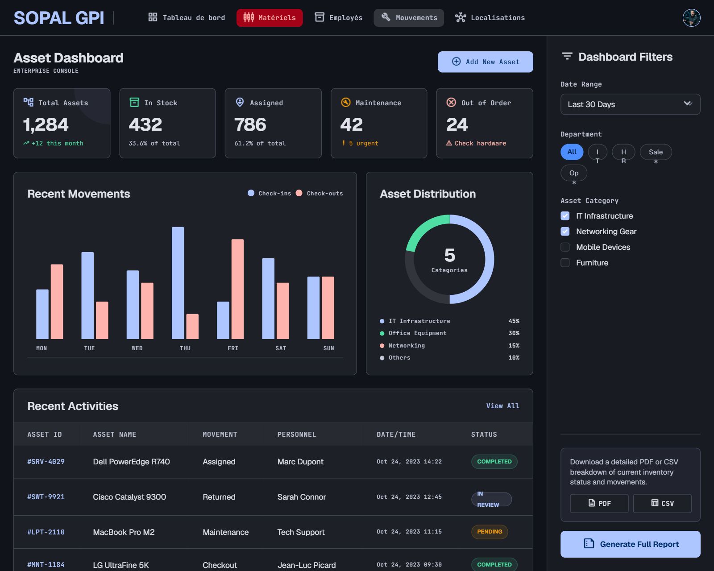
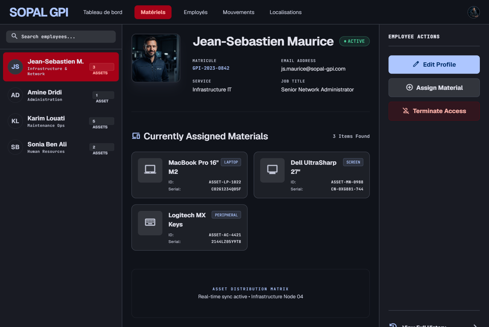
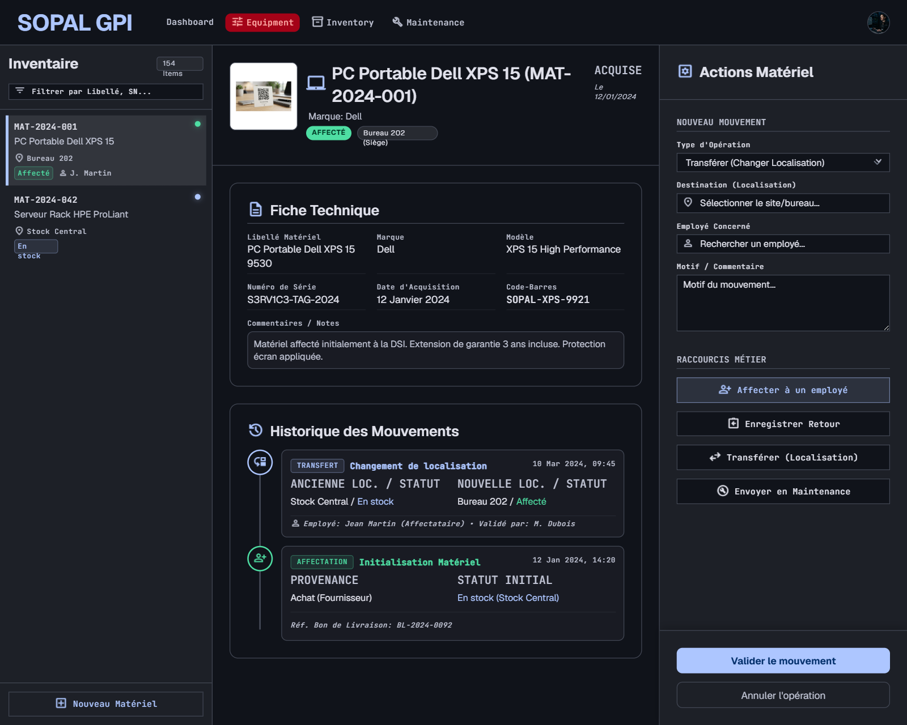
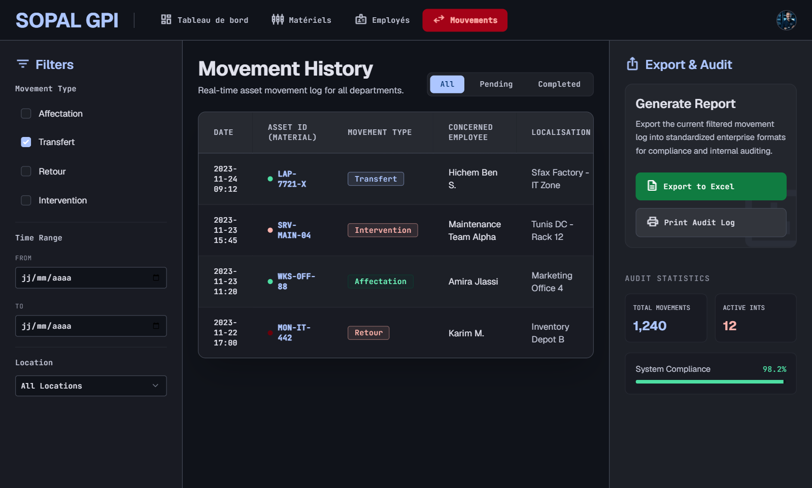
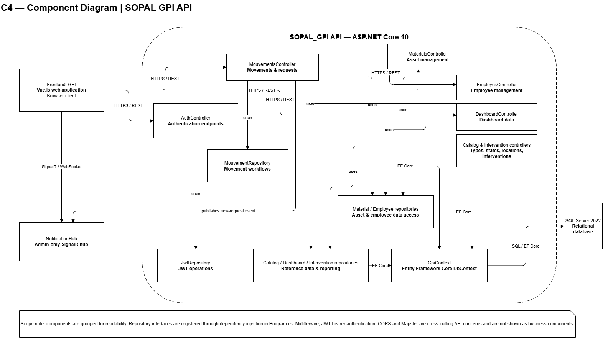
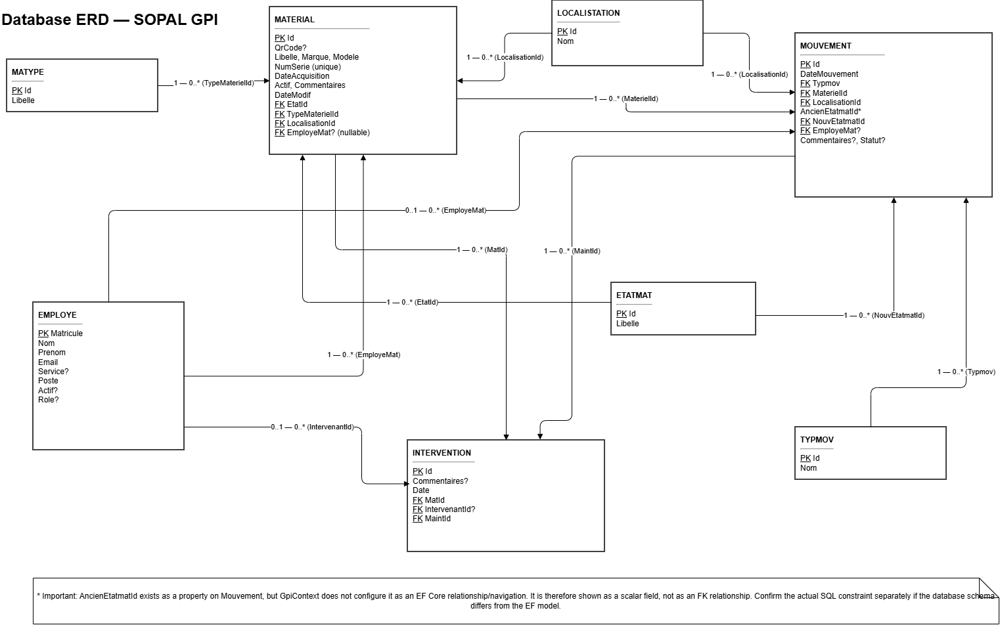
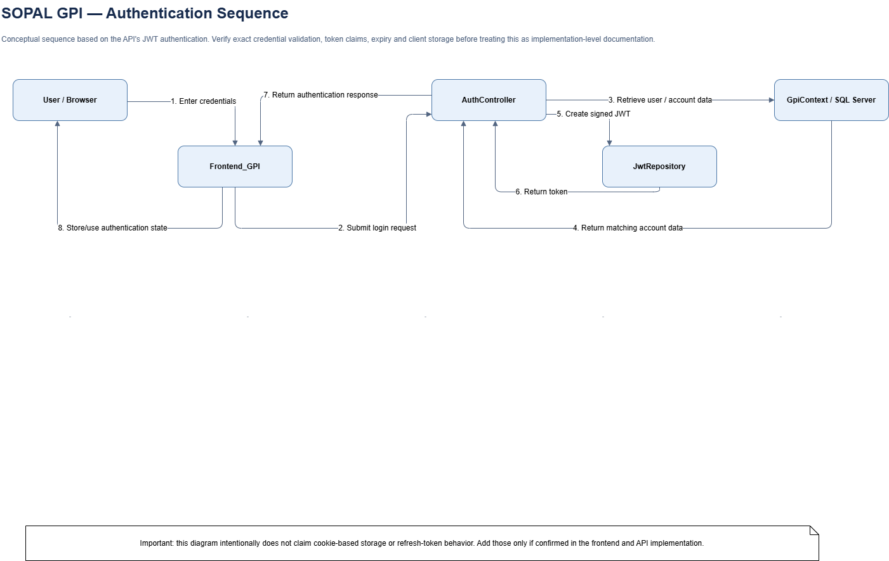
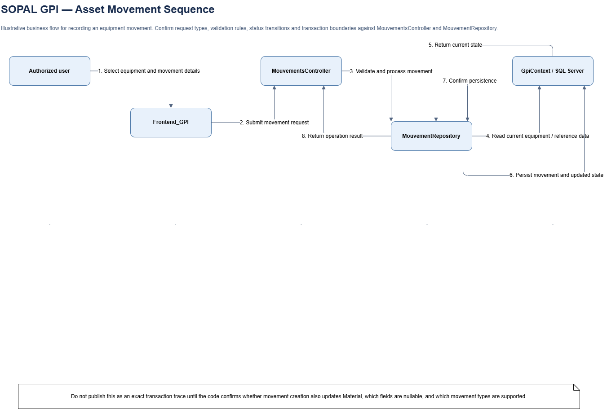
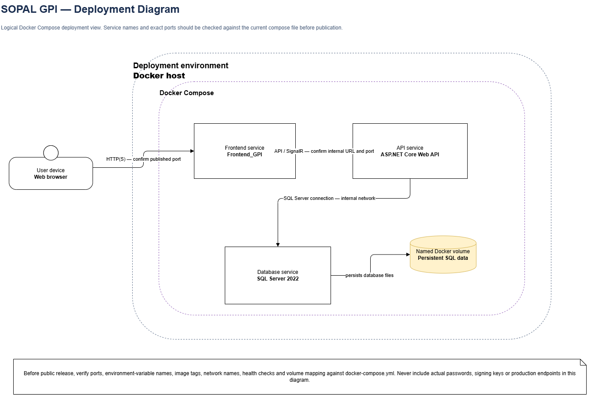

# SOPAL GPI — IT Asset Management System

A web-based IT Asset Management System built to centralize tracking, assignment, movement, and maintenance of IT equipment.

## Table of Contents

- [Overview](#overview)
- [Objectives](#objectives)
- [Features](#features)
- [User Interface](#user-interface)
- [System Architecture](#system-architecture)
- [Database Design](#database-design)
- [Application Workflows](#application-workflows)
- [Deployment Architecture](#deployment-architecture)
- [Technology Stack](#technology-stack)
- [Project Structure](#project-structure)
- [Getting Started](#getting-started)
- [Configuration](#configuration)
- [Running with Docker](#running-with-docker)
- [API Documentation](#api-documentation)
- [Security](#security)
- [Limitations and Future Improvements](#limitations-and-future-improvements)
- [Author](#author)
- [License](#license)

## Overview

SOPAL GPI is an IT asset management application developed to help organizations manage hardware inventory, employee assignments, equipment movements (assign/transfer/return), and maintenance requests from a single web interface.

## Project Preview


> Place a project preview image at `Architecture/project-preview.png` (add it to the repo when ready).

## Objectives

- Centralize IT asset information
- Maintain an inventory of equipment and availability
- Track assignments to employees
- Record transfers and returns with history
- Manage equipment status and locations
- Monitor intervention/maintenance requests
- Provide administrators an operational overview
- Offer a simple web UI for day-to-day operations

## Features

### Asset Management
- Create, update, and view IT equipment records
- Track identifiers such as serial numbers and asset details
- Associate assets with type, status, and location
- Monitor availability and assignment state

### Employee Management
- Maintain employee records
- Associate equipment with employees
- Support role-based access (admin/employee flows in the app)

### Equipment Movements
- Assign equipment to employees
- Transfer equipment between locations
- Process returns
- Keep movement history and statuses

### Maintenance / Interventions
- Submit intervention requests
- Track request status
- Allow admins to monitor incoming requests
- Real-time notifications to admins via SignalR when new requests arrive

### Dashboard
- Overview of key asset and movement information

## User Interface

Screenshots from UI mockups/design exports (stored in `Architecture/`):

| Dashboard (admin) | Employees management |
|---|---|
|  |  |

| Assets management | Movements history |
|---|---|
|  |  |

## System Architecture

The system uses a **frontend + backend API** architecture:

- **Frontend**: web client (React/Vite app in `Frontend/Frontend_GPI`)
- **Backend**: ASP.NET Core Web API (`SOPAL_GPI/`)
- **Database**: Microsoft SQL Server
- **Realtime**: SignalR hub for notifications (e.g., new intervention requests)

### C4 Model — System Context


### C4 Model — Component Diagram



## Database Design

Microsoft SQL Server with Entity Framework Core.

Main entities (typical for this domain): Employees, Materials (assets), Material Types, Material Statuses, Locations, Movement Types, Movements, Interventions.

### Entity Relationship Diagram



## Application Workflows

### Authentication Workflow



### Asset Movement Workflow




## Deployment Architecture

Containerized deployment via Docker Compose (API, SQL Server, Frontend). See `docker-compose.yml`.



## Technology Stack

| Category | Technology |
|---|---|
| Backend | ASP.NET Core Web API |
| Framework | .NET (see `SOPAL_GPI.csproj`) |
| Frontend | React + Vite (in `Frontend/Frontend_GPI`) |
| ORM | Entity Framework Core |
| Database | Microsoft SQL Server |
| Auth | JWT Bearer Authentication |
| Realtime | SignalR |
| Object Mapping | Mapster |
| API Docs | OpenAPI / Scalar (per project setup) |
| Containerization | Docker / Docker Compose |

## Project Structure

```text
SOPAL_GPI/
├── Architecture/                 # Diagrams and UI screenshots used in docs
├── Frontend/
│   └── Frontend_GPI/             # React/Vite frontend
├── SOPAL_GPI/                    # ASP.NET Core Web API
│   ├── Controllers/
│   ├── Data/
│   ├── DTOs/
│   ├── Hubs/
│   ├── MiddleWare/
│   ├── Models/
│   └── ...
├── docker-compose.yml
└── README.md
```

## Getting Started

### Prerequisites

- .NET SDK (compatible with the solution; see `SOPAL_GPI/SOPAL_GPI.csproj`)
- SQL Server (local) or Docker
- Node.js + npm (for frontend)
- Docker + Docker Compose (optional, recommended for quick start)
- Git

### Clone

```bash
git clone https://github.com/medjmal54/SOPAL_GPI.git
cd SOPAL_GPI
```

### Backend (local)

```bash
cd SOPAL_GPI
dotnet restore
dotnet run
```

### Frontend (local)

```bash
cd Frontend/Frontend_GPI
npm install
npm run dev
```

## Configuration

Backend configuration is typically provided via environment variables or `appsettings.*.json` (not committed). Common settings:

- `ConnectionStrings__DefaultConnection`
- `Jwt__Key`, `Jwt__Issuer`, `Jwt__Audience`
- `Cors__Frontend`

**Do not commit secrets.** Use environment variables, user-secrets, or local untracked files.

## Running with Docker

Review and adjust `docker-compose.yml` (credentials/ports) if needed, then:

```bash
docker compose up --build
```

Stop:

```bash
docker compose down
```

## API Documentation

When the API is running, open the OpenAPI/Scalar UI exposed by the backend (see launch settings / logs) to explore endpoints.

## Security

- JWT Bearer authentication for protected endpoints
- Role-based authorization (admin/user scenarios)
- Keep secrets out of source control
- Use strong JWT keys and secure connection strings in production

## Limitations and Future Improvements

- Add automated tests and CI coverage
- Improve audit history and reporting
- Expand intervention workflow (assignment, SLA)
- Add more complete API docs and deployment hardening

## Author

**medjmal54** — https://github.com/medjmal54

## License

Add a license file (e.g., MIT) if you plan to publish this repository publicly.
